<!-- Hero Animated Header -->

  

<!-- Dynamic Status Badges Ribbon -->

  
  
  
  

 

<!-- Terminal Navigation Menu Bar -->

  <a href="#-whoami"><code>[ 01. WHOAMI ]</code></a> •
  <a href="#-about-me"><code>[ 02. ABOUT ]</code></a> •
  <a href="#-global-infrastructure"><code>[ 03. INFRASTRUCTURE ]</code></a> •
  <a href="#-tech-stack--ecosystem"><code>[ 04. TECH STACK ]</code></a> •
  <a href="#-featured-architectures--projects"><code>[ 05. PROJECTS ]</code></a> •
  <a href="#-telemetry--leetcode-metrics"><code>[ 06. TELEMETRY & DSA ]</code></a> •
  <a href="#-connect--collaborate"><code>[ 07. CONNECT ]</code></a>

 

<!-- SECTION 1: WHOAMI -->
<h3 id="-whoami"><code>harshal@github ~ $ whoami --verbose</code></h3>

<table>
  <tr>
    <td valign="top" align="center"></td>
    <td valign="top"></td>
  </tr>
</table>

 

<!-- SECTION 2: ABOUT ME / EXECUTIVE PROFILE -->
<h3 id="-about-me"><code>harshal@github ~ $ cat /var/log/engineer_manifesto.md</code></h3>

<blockquote>

<b>Hey there, I'm Harshal Vidhate! 👋</b> 
I am a passionate <b>Full Stack Developer</b> (MERN Stack) and <b>Data Structures & Algorithms Enthusiast</b> based in <b>Pune, India</b>. I love crafting high-performance, real-world web applications, architecting intelligent systems (like multimodal assistive AI), and solving algorithmic problems on <b>LeetCode</b>.

</blockquote>

<table>
  <tr>
    <td width="50%" valign="top">
      <h4>⚡ Core Disciplines & Strengths</h4>
      <ul>
        <li><b>Full-Stack MERN Architecture:</b> Scalable reactive applications with React, Next.js, Node.js, Express, and MongoDB.</li>
        <li><b>DSA & Algorithmic Problem Solving:</b> Active competitive programmer on LeetCode with strong foundation in graphs, dynamic programming, and trees.</li>
        <li><b>AI & Multimodal Systems:</b> Building assistive platforms using multimodal perception, computer vision, and LLM integrations.</li>
        <li><b>Clean Code & System Design:</b> Modular REST APIs, state management, authentication, and database optimization.</li>
      </ul>
    </td>
    <td width="50%" valign="top">
      <h4>🎯 Current Focus & Highlights</h4>
      <ul>
        <li>🎓 <b>Engineering Student:</b> Pursuing engineering with an unrelenting drive to engineer top-tier software.</li>
        <li>🏆 <b>Hackathons & Innovations:</b> Built solutions for Smart India Hackathon (SIH 2026) and RIFT Hackathon.</li>
        <li>🚀 <b>Open for Opportunities:</b> Actively looking for <b>Software Engineering Internships</b> and full-time engineering roles.</li>
        <li>☕ <b>Life Philosophy:</b> Turning complex problems and hot coffee into clean, efficient code.</li>
      </ul>
    </td>
  </tr>
</table>

 

<!-- SECTION 3: GLOBAL DEPLOYMENT & 3D TECH SPHERE -->
<h3 id="-global-infrastructure"><code>harshal@github ~ $ ./deploy --global --interactive</code></h3>

<table>
  <tr>
    <td valign="top" align="center">
      
       
      <b>3D Global Network:</b> Routing from Pune (Home) to global cloud availability zones
    </td>
    <td valign="top" align="center">
      
       
      <b>Dynamic Tech Orbit:</b> Interactive 3D vector sphere rendered with pure SVG/SMIL
    </td>
  </tr>
</table>

 

<!-- SECTION 4: TECH STACK -->
<h3 id="-tech-stack--ecosystem"><code>harshal@github ~ $ neofetch --skills --detailed</code></h3>

  <b>Technologies, frameworks, and developer tools I build with:</b>

<!-- Languages & Core -->

  <b>Languages & Core</b> 
  
  
  
  
  
  
  

<!-- Frontend & UI -->

  <b>Frontend Engineering</b> 
  
  
  
  
  

<!-- Backend, APIs & Databases -->

  <b>Backend, APIs & Databases</b> 
  
  
  
  
  
  

<!-- AI, Cloud & Developer Tools -->

  <b>AI, Cloud & Developer Tooling</b> 
  
  
  
  
  
  

 

<!-- SECTION 5: FEATURED ARCHITECTURES & PROJECTS -->
<h3 id="-featured-architectures--projects"><code>harshal@github ~ $ git log --projects --featured --max-count=6</code></h3>

<table>
  <tr>
    <td width="50%" valign="top">
      <h3>🤖 AccessAi</h3>
      
<b>Autonomous Multimodal Assistive Intelligence Platform</b>

      
Empowers real-time multimodal perception (visual, auditory, cognitive, and mobility assistance) using computer vision and intelligent AI agents.

      

        
        
        
      

    </td>
    <td width="50%" valign="top">
      <h3>⚡ EVENTFLOW</h3>
      
<b>High-Throughput Event-Driven Microservices Platform</b>

      
Resilient cloud event orchestrator and asynchronous pipeline designed for high-concurrency event publishing, streaming, and workflow processing.

      

        
        
        
      

    </td>
  </tr>
  <tr>
    <td width="50%" valign="top">
      <h3>🗺️ PATHFINDER</h3>
      
<b>Intelligent Spatial Routing & Graph Navigation Engine</b>

      
Algorithmic graph routing engine featuring Dijkstra, A*, and heuristic path optimization for topological pathfinding and network navigation.

      

        
        
        
      

    </td>
    <td width="50%" valign="top">
      <h3>🏆 MAPLAD-SIH-2026</h3>
      
<b>Smart India Hackathon 2026 Flagship Project</b>

      
National hackathon solution built for land asset mapping, spatial analytics, and automated geo-tracking to modernize resource planning.

      

        
        
        
      

    </td>
  </tr>
  <tr>
    <td width="50%" valign="top">
      <h3>🔬 Quantum-Nav</h3>
      
<b>Quantum Route & Combinatorial Optimization Platform</b>

      
Hybrid combinatorial optimization framework utilizing simulated quantum annealing heuristics to solve complex high-density logistics routing.

      

        
        
      

    </td>
    <td width="50%" valign="top">
      <h3>📦 RETURN-IQ & Lead-Desk-mini</h3>
      
<b>Enterprise SaaS & CRM Intelligence</b>

      
Smart inventory return analysis paired with lead management dashboards for seamless business workflow automation.

      

        
        
      

    </td>
  </tr>
</table>

 

<!-- SECTION 6: GITHUB TELEMETRY & LEETCODE -->
<h3 id="-telemetry--leetcode-metrics"><code>harshal@github ~ $ gh telemetry --metrics --leetcode</code></h3>

<!-- LeetCode Card -->

  <b>🧩 LeetCode Problem Solving Telemetry (Handle: <code>ROY444704</code>)</b> 
  

 

<!-- GitHub Stats & Streak Table -->
<table>
  <tr>
    <td valign="top" align="center">
      
    </td>
    <td valign="top" align="center">
      
    </td>
  </tr>
  <tr>
    <td colspan="2" align="center">
      
    </td>
  </tr>
</table>

 

<!-- SECTION 7: 3D SKYLINE & HEATMAP & SNAKE -->
<h3><code>harshal@github ~ $ ./skyline --3d --isometric</code></h3>

Isometric 3D city rendered from Harshal's 600+ GitHub contributions

  

<h3><code>harshal@github ~ $ ./contributions.sh --stream</code></h3>

Activity matrix with active commit velocity and streak tracking

  

<h3><code>harshal@github ~ $ ./snake --eat-commits --dark-mode</code></h3>

Autonomous snake traversing the contribution graph

  

<!-- SECTION 8: CONNECT & GET IN TOUCH -->
<h3 id="-connect--collaborate"><code>harshal@github ~ $ ./connect --direct-links</code></h3>

  <b>Let's build impactful software and collaborate together!</b> 
  I'm actively looking for <b>Software Engineering Internships</b>, full-stack collaborations, and open-source contributions.

  
  &nbsp;
  
  &nbsp;
  
  &nbsp;
  

 

<!-- Developer Quote -->

  

 

<!-- Terminal Footer -->
<table>
  <tr>
    <td align="center">
      
        ⚡ Powered by <b>Python</b> in <code><a href="./scripts">scripts/</a></code> • Refreshed continuously via <b>GitHub Actions</b> • Built with ❤️ by <a href="https://github.com/Harshal844600"><b>Harshal Vidhate</b></a>
      
    </td>
  </tr>
</table>

